```mermaid
graph LR
  subgraph "official.base"
    template_pc["你"]
    template_prop_crate["木箱"]
    template_item_lamp["油灯"]
    terrain_0["空"]
    terrain_1["墙"]
    terrain_2["水"]
    terrain_3["地面"]
    terrain_4["洞底"]
    component_core_health["生命"]
    component_core_stats["属性"]
    component_core_body["身体"]
    component_core_item["物品"]
    component_core_container["物品栏"]
    component_core_ai["智能"]
    component_core_solid["实心"]
    component_core_sprite["贴图"]
    component_core_intent["意图"]
    component_core_pending["挂起"]
    component_core_use["用法"]
    component_core_dialog["对话"]
    component_core_disposition["阵营"]
    component_core_persistence["存在感"]
    component_core_melee["近战"]
    component_core_locomotion["行动方式"]
    traversal_base_traversal["base.traversal"]
    biome_temperate["温带"]
    biome_swamp["湿地"]
    biome_dry["旱地"]
  end
  subgraph "official.tiles"
    space_tiles["tiles"]
    world_main["main"]
  end
  subgraph "(代码)"
    rule_core_move["走一步"]
    rule_core_take["捡起"]
    rule_core_drop["放下"]
    rule_core_wait["等待"]
    rule_core_aim["指向"]
    rule_base_attack["劈砍"]
    rule_core_use["使用"]
    rule_base_rest["休息"]
    rule_base_rest_finish["休息结算"]
  end
  space_tiles --> terrain_1
  space_tiles --> terrain_3
  template_item_lamp --> component_core_item
  template_pc --> component_core_container
  template_pc --> component_core_health
  template_pc --> component_core_pending
  template_pc --> component_core_solid
  template_pc --> component_core_stats
  template_prop_crate --> component_core_health
  template_prop_crate --> component_core_solid
  world_main --> rule_base_attack
  world_main --> rule_base_rest
  world_main --> rule_base_rest_finish
  world_main --> rule_core_aim
  world_main --> rule_core_drop
  world_main --> rule_core_move
  world_main --> rule_core_take
  world_main --> rule_core_use
  world_main --> rule_core_wait
  world_main --> space_tiles
```

# 世界包引用图

> 由 `node tools/gen-pack-graph.mjs` 生成，不要手改。
> 与 [dependency-tree.md](dependency-tree.md) 互补：那边是代码 import，这边是数据引用。

## official.cavern

包：official.base + official.cavern

| 种类 | 数量 |
|---|---|
| component | 16 |
| rule | 9 |
| terrain | 5 |
| template | 3 |
| biome | 3 |
| traversal | 1 |
| space | 1 |
| world | 1 |

## official.dungeon

包：official.base + official.dungeon

| 种类 | 数量 |
|---|---|
| component | 16 |
| rule | 12 |
| terrain | 5 |
| template | 4 |
| biome | 3 |
| traversal | 1 |
| space | 1 |
| group | 1 |
| world | 1 |

```mermaid
graph LR
  subgraph "official.base"
    template_pc["你"]
    template_prop_crate["木箱"]
    template_item_lamp["油灯"]
    terrain_0["空"]
    terrain_1["墙"]
    terrain_2["水"]
    terrain_3["地面"]
    terrain_4["洞底"]
    component_core_health["生命"]
    component_core_stats["属性"]
    component_core_body["身体"]
    component_core_item["物品"]
    component_core_container["物品栏"]
    component_core_ai["智能"]
    component_core_solid["实心"]
    component_core_sprite["贴图"]
    component_core_intent["意图"]
    component_core_pending["挂起"]
    component_core_use["用法"]
    component_core_dialog["对话"]
    component_core_disposition["阵营"]
    component_core_persistence["存在感"]
    component_core_melee["近战"]
    component_core_locomotion["行动方式"]
    traversal_base_traversal["base.traversal"]
    biome_temperate["温带"]
    biome_swamp["湿地"]
    biome_dry["旱地"]
  end
  subgraph "official.dungeon"
    space_cave["cave"]
    template_rat["洞鼠"]
    group_nest["nest"]
    world_main["main"]
  end
  subgraph "(代码)"
    rule_core_move["走一步"]
    rule_core_take["捡起"]
    rule_core_drop["放下"]
    rule_core_wait["等待"]
    rule_core_aim["指向"]
    rule_base_attack["劈砍"]
    rule_core_enemy_turn["敌人思考"]
    rule_core_enemy_windup["敌人起手"]
    rule_core_enemy_strike["敌人出手"]
    rule_core_use["使用"]
    rule_base_rest["休息"]
    rule_base_rest_finish["休息结算"]
  end
  space_cave --> terrain_1
  space_cave --> terrain_3
  template_item_lamp --> component_core_item
  template_pc --> component_core_container
  template_pc --> component_core_health
  template_pc --> component_core_pending
  template_pc --> component_core_solid
  template_pc --> component_core_stats
  template_prop_crate --> component_core_health
  template_prop_crate --> component_core_solid
  template_rat --> component_core_disposition
  template_rat --> component_core_health
  template_rat --> component_core_intent
  template_rat --> component_core_locomotion
  template_rat --> component_core_melee
  template_rat --> component_core_solid
  world_main --> rule_base_attack
  world_main --> rule_base_rest
  world_main --> rule_base_rest_finish
  world_main --> rule_core_aim
  world_main --> rule_core_drop
  world_main --> rule_core_enemy_strike
  world_main --> rule_core_enemy_turn
  world_main --> rule_core_enemy_windup
  world_main --> rule_core_move
  world_main --> rule_core_take
  world_main --> rule_core_use
  world_main --> rule_core_wait
  world_main --> space_cave
```

## official.labyrinth

包：official.base + official.labyrinth

| 种类 | 数量 |
|---|---|
| component | 16 |
| rule | 10 |
| terrain | 5 |
| template | 3 |
| biome | 3 |
| traversal | 1 |
| space | 1 |
| world | 1 |

## official.normal

包：official.base + official.normal

| 种类 | 数量 |
|---|---|
| component | 16 |
| rule | 15 |
| template | 5 |
| terrain | 5 |
| biome | 3 |
| traversal | 1 |
| space | 1 |
| group | 1 |
| world | 1 |

```mermaid
graph LR
  subgraph "official.base"
    template_pc["你"]
    template_prop_crate["木箱"]
    template_item_lamp["油灯"]
    terrain_0["空"]
    terrain_1["墙"]
    terrain_2["水"]
    terrain_3["地面"]
    terrain_4["洞底"]
    component_core_health["生命"]
    component_core_stats["属性"]
    component_core_body["身体"]
    component_core_item["物品"]
    component_core_container["物品栏"]
    component_core_ai["智能"]
    component_core_solid["实心"]
    component_core_sprite["贴图"]
    component_core_intent["意图"]
    component_core_pending["挂起"]
    component_core_use["用法"]
    component_core_dialog["对话"]
    component_core_disposition["阵营"]
    component_core_persistence["存在感"]
    component_core_melee["近战"]
    component_core_locomotion["行动方式"]
    traversal_base_traversal["base.traversal"]
    biome_temperate["温带"]
    biome_swamp["湿地"]
    biome_dry["旱地"]
  end
  subgraph "official.normal"
    space_field["field"]
    template_npc_salt["盐商"]
    template_item_potion["药水"]
    group_camp["camp"]
    world_main["main"]
  end
  subgraph "(代码)"
    rule_core_move["走一步"]
    rule_core_take["捡起"]
    rule_core_drop["放下"]
    rule_base_attack["劈砍"]
    rule_core_wait["等待"]
    rule_core_aim["指向"]
    rule_core_enemy_turn["敌人思考"]
    rule_core_enemy_windup["敌人起手"]
    rule_core_enemy_strike["敌人出手"]
    rule_base_cast["蓄力劈砍"]
    rule_core_use["使用"]
    rule_base_talk["交谈"]
    rule_base_sweep["横扫"]
    rule_base_rest["休息"]
    rule_base_rest_finish["休息结算"]
  end
  space_field --> terrain_1
  space_field --> terrain_2
  space_field --> terrain_3
  template_item_lamp --> component_core_item
  template_item_potion --> component_core_item
  template_item_potion --> component_core_locomotion
  template_item_potion --> component_core_sprite
  template_item_potion --> component_core_use
  template_npc_salt --> component_core_ai
  template_npc_salt --> component_core_dialog
  template_npc_salt --> component_core_disposition
  template_npc_salt --> component_core_health
  template_npc_salt --> component_core_intent
  template_npc_salt --> component_core_locomotion
  template_npc_salt --> component_core_melee
  template_npc_salt --> component_core_persistence
  template_npc_salt --> component_core_solid
  template_npc_salt --> component_core_stats
  template_pc --> component_core_container
  template_pc --> component_core_health
  template_pc --> component_core_pending
  template_pc --> component_core_solid
  template_pc --> component_core_stats
  template_prop_crate --> component_core_health
  template_prop_crate --> component_core_solid
  world_main --> rule_base_attack
  world_main --> rule_base_cast
  world_main --> rule_base_rest
  world_main --> rule_base_rest_finish
  world_main --> rule_base_sweep
  world_main --> rule_base_talk
  world_main --> rule_core_aim
  world_main --> rule_core_drop
  world_main --> rule_core_enemy_strike
  world_main --> rule_core_enemy_turn
  world_main --> rule_core_enemy_windup
  world_main --> rule_core_move
  world_main --> rule_core_take
  world_main --> rule_core_use
  world_main --> rule_core_wait
  world_main --> space_field
```

## official.rooms

包：official.base + official.rooms

| 种类 | 数量 |
|---|---|
| component | 16 |
| rule | 10 |
| terrain | 5 |
| template | 3 |
| biome | 3 |
| traversal | 1 |
| space | 1 |
| world | 1 |

```mermaid
graph LR
  subgraph "official.base"
    template_pc["你"]
    template_prop_crate["木箱"]
    template_item_lamp["油灯"]
    terrain_0["空"]
    terrain_1["墙"]
    terrain_2["水"]
    terrain_3["地面"]
    terrain_4["洞底"]
    component_core_health["生命"]
    component_core_stats["属性"]
    component_core_body["身体"]
    component_core_item["物品"]
    component_core_container["物品栏"]
    component_core_ai["智能"]
    component_core_solid["实心"]
    component_core_sprite["贴图"]
    component_core_intent["意图"]
    component_core_pending["挂起"]
    component_core_use["用法"]
    component_core_dialog["对话"]
    component_core_disposition["阵营"]
    component_core_persistence["存在感"]
    component_core_melee["近战"]
    component_core_locomotion["行动方式"]
    traversal_base_traversal["base.traversal"]
    biome_temperate["温带"]
    biome_swamp["湿地"]
    biome_dry["旱地"]
  end
  subgraph "official.rooms"
    space_rooms["rooms"]
    world_main["main"]
  end
  subgraph "(代码)"
    rule_core_move["走一步"]
    rule_core_take["捡起"]
    rule_core_drop["放下"]
    rule_core_wait["等待"]
    rule_core_aim["指向"]
    rule_base_attack["劈砍"]
    rule_base_cast["蓄力劈砍"]
    rule_core_use["使用"]
    rule_base_rest["休息"]
    rule_base_rest_finish["休息结算"]
  end
  space_rooms --> terrain_1
  space_rooms --> terrain_3
  template_item_lamp --> component_core_item
  template_pc --> component_core_container
  template_pc --> component_core_health
  template_pc --> component_core_pending
  template_pc --> component_core_solid
  template_pc --> component_core_stats
  template_prop_crate --> component_core_health
  template_prop_crate --> component_core_solid
  world_main --> rule_base_attack
  world_main --> rule_base_cast
  world_main --> rule_base_rest
  world_main --> rule_base_rest_finish
  world_main --> rule_core_aim
  world_main --> rule_core_drop
  world_main --> rule_core_move
  world_main --> rule_core_take
  world_main --> rule_core_use
  world_main --> rule_core_wait
  world_main --> space_rooms
```

## official.tiles

包：official.base + official.tiles

| 种类 | 数量 |
|---|---|
| component | 16 |
| rule | 9 |
| terrain | 5 |
| template | 3 |
| biome | 3 |
| traversal | 1 |
| space | 1 |
| world | 1 |

