# 世界包引用图

> 由 `node tools/gen-pack-graph.mjs` 生成，不要手改。
> 与 [dependency-tree.md](dependency-tree.md) 互补：那边是代码 import，这边是数据引用。

## official.normal

包：official.base + official.normal

| 种类 | 数量 |
|---|---|
| component | 13 |
| rule | 12 |
| template | 5 |
| entity | 5 |
| terrain | 4 |
| space | 1 |
| group | 1 |
| world | 1 |

```mermaid
graph LR
  subgraph "official.base"
    template_pc["你"]
    template_prop_crate["木箱"]
    template_item_lamp["油灯"]
    terrain_0["空"]
    terrain_1["墙"]
    terrain_2["水"]
    terrain_3["地面"]
    component_core_health["生命"]
    component_core_stats["属性"]
    component_core_body["部位"]
    component_core_item["物品"]
    component_core_container["物品栏"]
    component_core_ai["智能"]
    component_core_solid["实心"]
    component_core_sprite["贴图"]
    component_core_intent["意图"]
    component_core_pending["core.pending"]
    component_core_use["用法"]
    component_core_dialog["对话"]
    component_core_disposition["阵营"]
  end
  subgraph "official.normal"
    space_harbor["harbor"]
    template_npc_salt["盐商"]
    template_item_potion["药水"]
    entity_pc["pc"]
    entity_salt["salt"]
    entity_crate["crate"]
    entity_lamp["lamp"]
    entity_potion["potion"]
    group_camp["camp"]
    world_main["main"]
  end
  subgraph "(代码)"
    rule_core_move["走一步"]
    rule_core_take["捡起"]
    rule_core_drop["放下"]
    rule_base_attack["劈砍"]
    rule_core_wait["等待"]
    rule_core_aim["指向"]
    rule_core_enemy_turn["敌人思考"]
    rule_core_enemy_windup["敌人起手"]
    rule_core_enemy_strike["敌人出手"]
    rule_base_cast["蓄力劈砍"]
    rule_core_use["使用"]
    rule_base_talk["交谈"]
  end
  entity_crate --> space_harbor
  entity_crate --> template_prop_crate
  entity_lamp --> space_harbor
  entity_lamp --> template_item_lamp
  entity_pc --> space_harbor
  entity_pc --> template_pc
  entity_potion --> space_harbor
  entity_potion --> template_item_potion
  entity_salt --> space_harbor
  entity_salt --> template_npc_salt
  space_harbor --> terrain_1
  space_harbor --> terrain_2
  space_harbor --> terrain_3
  template_item_lamp --> component_core_item
  template_item_potion --> component_core_item
  template_item_potion --> component_core_sprite
  template_item_potion --> component_core_use
  template_npc_salt --> component_core_ai
  template_npc_salt --> component_core_dialog
  template_npc_salt --> component_core_disposition
  template_npc_salt --> component_core_health
  template_npc_salt --> component_core_intent
  template_npc_salt --> component_core_solid
  template_npc_salt --> component_core_stats
  template_pc --> component_core_container
  template_pc --> component_core_health
  template_pc --> component_core_pending
  template_pc --> component_core_solid
  template_pc --> component_core_stats
  template_prop_crate --> component_core_health
  template_prop_crate --> component_core_solid
  world_main --> rule_base_attack
  world_main --> rule_base_cast
  world_main --> rule_base_talk
  world_main --> rule_core_aim
  world_main --> rule_core_drop
  world_main --> rule_core_enemy_strike
  world_main --> rule_core_enemy_turn
  world_main --> rule_core_enemy_windup
  world_main --> rule_core_move
  world_main --> rule_core_take
  world_main --> rule_core_use
  world_main --> rule_core_wait
  world_main --> space_harbor
```

